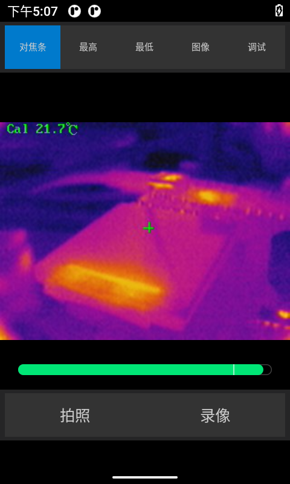
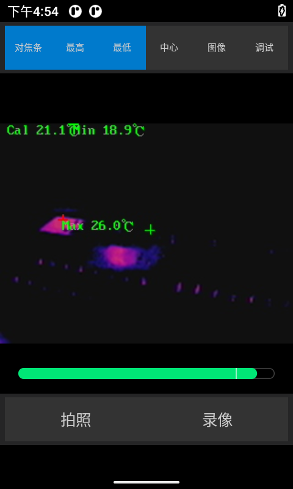
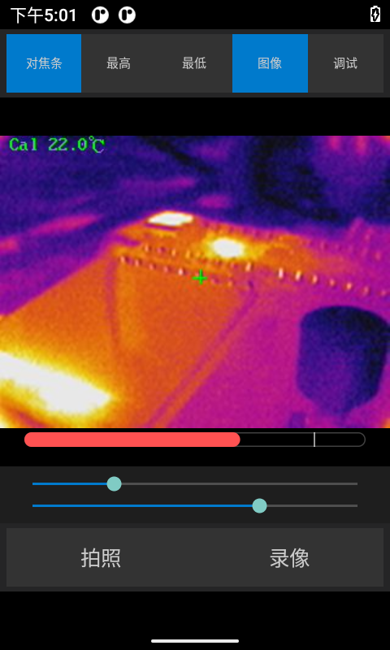

# tb4117-uvc-android

[](https://github.com/ymyjwbckadnhz/tb4117-uvc-android/actions/workflows/build.yml)

> 一个不依赖厂商 SDK 的 Android 热成像查看器，通过标准 **USB Video Class (UVC)** 协议直接读取 TB-4117 系列热成像机芯的 MJPEG 视频流，并用 UVC 扩展单元（XU）控制测温叠加、亮度、对比度等参数。

**非官方项目，与海康威视及任何模组厂商无关。** 详见 [NOTICE](NOTICE)。

---

## 下载

| 包 | 签名 | 说明 |
|---|---|---|
| `tb4117-uvc-v0.2-release.apk` | **正式签名**（`CN=TB4117 UVC`） | 推荐安装；以后升级无需卸载 |
| `tb4117-uvc-v0.2-debug.apk` | 调试签名 | 早期构建，仅存档 |

发行版地址：

- GitHub <https://github.com/ymyjwbckadnhz/tb4117-uvc-android/releases>
- Gitee <https://gitee.com/OvO_rain/tb4117-uvc-android/releases>

> 两个签名不通用。从 debug 包换成 release 包时要先卸载旧版，
> 之后同一个 key 签的版本才能覆盖安装。

## 功能

| 功能 | 说明 |
|---|---|
| **即插即用** | 手机 OTG 接上机芯即可出图，无需安装厂商 App，无需切 NCM 模式 |
| **对焦辅助** | 底部横向进度条，Tenengrad 梯度算法实时评价清晰度；峰值标记 + 场景切换自动复位 |
| **测温叠加开关** | 最高温 / 最低温 两个独立开关（由机芯 OSD 绘制数值） |
| **亮度 / 对比度** | 可开关的滑块面板，实时读写机芯参数 |
| **拍照** | 一键存 JPG（含 OSD），保存到相册 `Pictures/4117/` |
| **录像** | 一键录 **MP4 (H.264)**，保存到 `Movies/4117/`；编码器不可用时自动回落 MJPEG AVI |
| **深色 UI** | VS Code 深色配色，预览区无干扰（无数字、无文字） |
| **远程控制** | 支持 adb 广播控制，方便自动化测试 |

## 截图

| 主界面 | 测温叠加 | 图像调节 |
|---|---|---|
|  |  |  |

> **Gitee 用户注意**：Gitee 的 README 渲染器不解析相对路径的图片（会 404），这是平台限制，不是仓库缺文件。
> 图片显示不出来时，直接点这三个链接查看：
> [主界面](https://gitee.com/OvO_rain/tb4117-uvc-android/raw/main/docs/screenshots/main.png) ·
> [测温叠加](https://gitee.com/OvO_rain/tb4117-uvc-android/raw/main/docs/screenshots/overlay.png) ·
> [图像调节](https://gitee.com/OvO_rain/tb4117-uvc-android/raw/main/docs/screenshots/adjust.png)

## 兼容性

- **机芯**：USB `2bdf:0101`（HikCamera / TB-4117 系列，UVC 1.10）。代码按 VID 匹配，不同 PID 也能尝试打开。
- **手机**：Android 8.0+（minSdk 26），建议 Android 10+（相册保存走 MediaStore）。
- **供电**：机芯从 USB 取电，部分手机 OTG 口限流 500 mA 带不动。若出现反复重连，请使用**带外接供电的 OTG 分线器**。

## 安装

1. 下载 [Releases](../../releases) 里的 `tb4117-uvc-v0.2.apk`；
2. 手机上允许"安装未知来源应用"；
3. 打开 App，**先允许相机权限**（Android 把 UVC 设备归类为相机，没有该权限拿不到 USB 设备），再允许 USB 设备访问；
4. 插入机芯，画面自动出现。

> 若安装报 `INSTALL_FAILED_UPDATE_INCOMPATIBLE`，说明之前装过不同签名的版本，先卸载旧版。

## 使用

顶栏：`对焦条` `最高` `最低` `图像` `调试`；底栏：`拍照` `录像`。

- **对焦条**：显示清晰度（颜色从红到绿），白色刻度线是 85% 参考位；转到最清晰时条最长、变绿；
- **图像**：展开亮度/对比度滑块，打开时先读回机芯当前值；
- **调试**：展开串口日志（DUMP / 探测 / 开流 / 峰值 / 对焦），排障用。

### adb 广播控制（便于自动化）

```bash
adb shell am broadcast -a com.dsh.uvctest.CMD --es cmd photo
adb shell am broadcast -a com.dsh.uvctest.CMD --es cmd rec          # 再发一次 = 停止
adb shell am broadcast -a com.dsh.uvctest.CMD --es cmd bar          # 对焦条开关
adb shell am broadcast -a com.dsh.uvctest.CMD --es cmd max
adb shell am broadcast -a com.dsh.uvctest.CMD --es cmd min
adb shell am broadcast -a com.dsh.uvctest.CMD --es cmd adj          # 图像面板开关
adb shell am broadcast -a com.dsh.uvctest.CMD --es cmd bright --ei v 60
adb shell am broadcast -a com.dsh.uvctest.CMD --es cmd contrast --ei v 60
```

日志文件：`/sdcard/Android/data/com.dsh.uvctest/files/uvctest.log`

## 已知限制

1. **UVC 模式下读不到实时温度**。机芯的最高/最低温数值是它自己画进视频流的，本程序只能开关这些叠加层，无法获取数值（`2046/2047` 测温命令在本固件返回空）。想要逐像素温度需要走 ISAPI/NCM。
2. 视频分辨率取决于机芯输出，常见为 **320×240**。
3. 录音没有（只有视频轨）。
4. 录像帧率约 24 fps（取帧 + JPEG 解码开销），不是严格 25。

## 编译

不依赖 Gradle，用 Android SDK 命令行工具直接构建：

```powershell
# 需要：JDK 17+、Android SDK build-tools、platforms/android-30
$env:ANDROID_SDK = "C:\path\to\Android\Sdk"
.\build\build.ps1            # 生成未签名 debug 包
.\build\build_release.ps1    # 生成已签名 release 包
```

签名密钥不入库：`build_release.ps1` 从环境变量读取

```powershell
$env:KEYSTORE      = "path\to\your.keystore"
$env:KEYSTORE_PASS = "yourpass"
$env:KEY_ALIAS     = "youralias"
```

## 协议说明

见 [docs/protocol.md](docs/protocol.md)：UVC XU 命令帧格式、常用命令号、结构体字段偏移，全部来自 **USB 总线抓包观察**，用于互操作性。

## 致谢

- 机芯的 MJPEG 流格式与 UVC 扩展单元行为参考了公开的热成像 UVC 逆向资料；
- 对焦评价使用 Tenengrad 梯度算法。

## 许可证

[Apache License 2.0](LICENSE)

---

# English

An Android **UVC** thermal camera viewer for TB-4117-class modules that works
without any vendor SDK: it grabs the standard MJPEG stream and drives the
module's vendor-specific XU controls (temperature overlays, brightness,
contrast).

**Unofficial project — not affiliated with Hikvision or any module vendor.**

Features: plug-and-play preview, focus-assist bar (Tenengrad), max/min
overlay toggles, brightness/contrast sliders, JPG photo capture, MP4 (H.264)
recording with automatic MJPEG-AVI fallback, VS Code dark theme, adb broadcast
control for automation.

Requirements: Android 8.0+ (10+ recommended), USB-OTG with enough current
(use a powered hub if the module keeps reconnecting).

Install: download the APK from Releases, grant **camera** permission (required
for UVC access on Android) and then the USB device permission.

Known limitation: live temperature values are **not** readable over UVC on
this firmware — only the on-device OSD overlays can be toggled.

Build: no Gradle needed, see `build/build.ps1` and `build/build_release.ps1`.

Protocol notes (from USB bus observation): [docs/protocol.md](docs/protocol.md).

License: Apache-2.0.
